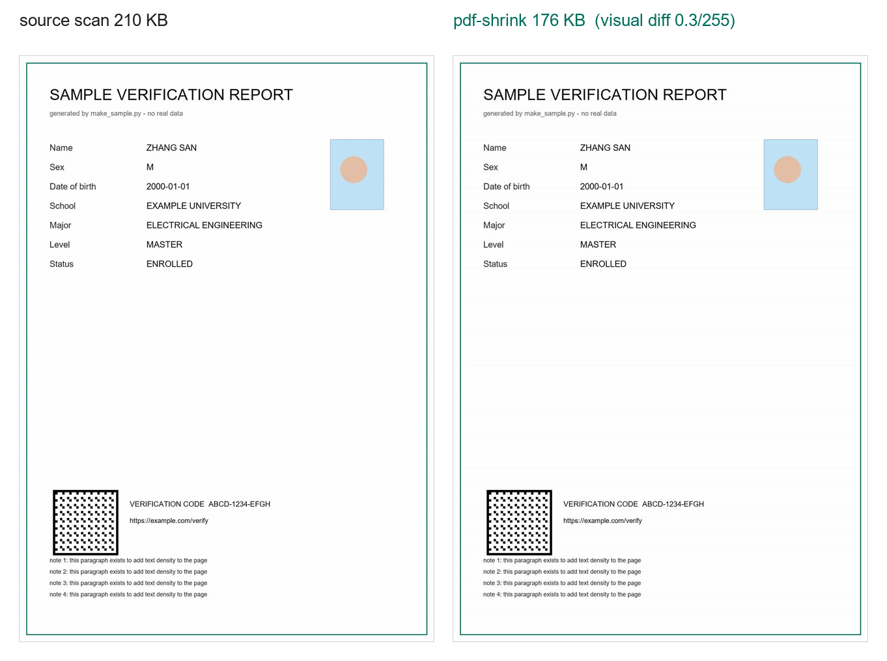

# pdf-shrink

Shrink a PDF, or turn one into JPG/PNG, **without turning the text to mush**.

Most "compress PDF" tools rasterize the page or re-subset the fonts badly. Chinese
documents generated by iText / reportlab make it worse: one A4 page can carry a
230 KB embedded CJK font subset, plus a 180 KB anti-counterfeit background — that
is a 470 KB file for one page of text.

`pdf-shrink` rebuilds the page as **three layers** instead, so the thing that
actually costs bytes (the font) is replaced by something cheap, while the text
stays sharp.

| | before | after |
|---|---|---|
| Chinese degree-verification report (1 page) | 471 KB | **187 KB** |
| University transcript (1 page, vector) | 244 KB | **32 KB** |
| Graduate recommendation form (2 pages) | 451 KB | **189 KB** |
| CNIPA utility-model certificate (guilloche border) | 1.0 MB | **167 KB** |

A synthetic sample page, 210 KB → 78 KB, 400 dpi text, QR still scans, tint and border intact:



*A synthetic sample (no real data): the page is one scan, so there is no font to
remove — the win here is a cleaner re-encode. The table above is the case this
tool exists for: a vector page carrying a 230 KB CJK font subset.*

## How it works

```
          ┌──────────────────────────────┐
 original │  background artwork (1200×1698, 13 colours, PNG predictor) │  ≈150 KB
   PDF    │  text + vector  →  400 dpi render → 1-bit → CCITT G4 mask │  ≈25 KB
 (471 KB) │  photo / logo / QR  →  per-rectangle layers               │  ≈10 KB
          └──────────────────────────────┘   → 187 KB
```

1. **Background artwork** — the image drawn across the whole page is kept
   pixel-for-pixel but re-encoded: palette de-duplicated (23 → 13 colours),
   PNG row predictors + Flate (≈180 KB → ≈150 KB), embedded directly as an
   `/Indexed` `/FlateDecode` image with `/Predictor 15`.
2. **Text layer** — the page is re-rendered *with every image `Do` removed from
   the content stream*, so the render contains only text and vector art. It is
   thresholded to 1 bit and stored as an **`/ImageMask` + CCITT G4** stencil
   painted black over the artwork. A few tens of KB replace a 200 KB+ font.
3. **Overlays** — photos, logos and QR codes are pulled out by their original
   `cm` matrix and placed back at the exact rectangle. Bilevel content (QR) goes
   to 1-bit Flate, photos to JPEG, and `/SMask` transparency is composited onto
   the artwork beneath it so no white box appears.

If the result does not fit the budget the encoder walks a ladder
(400 → 380 → … → 200 dpi, then artwork off), and finally falls back to a flat
JPEG per page.

### It checks its own work

Every run renders the source page and the output page at the same size and
reports the mean luminance difference:

```
  dpi=400 art=True -> 191029 bytes (187 KB)
  visual diff vs source: 2.2/255
```

Above `12/255` the layered build is considered wrong (this happens on PDF 1.5+
files whose page tree hides in object streams) and the tool **falls back
automatically** instead of shipping a page with missing photos or seals.

## Requirements

- **Windows 10/11** — rendering uses `Windows.Data.Pdf` through PowerShell +
  WinRT, so there is nothing to install (no Ghostscript, no poppler, no MuPDF).
- **Python 3.9+** with **Pillow** (`pip install pillow`). Only `Pillow` is
  required; everything else is the Python standard library.

## Usage

### PDF → smaller PDF

```bash
python pdf_shrink.py input.pdf output.pdf --target-kb 200
```

```
pages: [11] objects: 17 embedded: 0
 page 0: media (0.0, 0.0, 595.0, 842.0) bg=True overlays=3
artwork images: {1: (1200, 1698)}
  dpi=400 art=True -> 191029 bytes (187 KB)
  visual diff vs source: 2.2/255
wrote output.pdf  191029 bytes = 186.6 KB (target <= 200 KB)
```

### PDF → JPG / PNG (upload forms that only accept images)

```bash
python pdf_to_image.py input.pdf out_prefix --target-kb 200
```

It picks the **highest dpi that fits**, instead of a fixed dpi:

```
rec.pdf: 2 page(s), target <= 195 KB
  page 1 -> rec_p1.jpg  194.6 KB  1654x2341  dpi=200 q=52 color
  page 2 -> rec_p2.jpg  194.6 KB  1819x2574  dpi=220 q=60 color
```

Multi-page files produce `out_p1.jpg`, `out_p2.jpg`, … — upload each page
separately. Useful flags:

| flag | why |
|---|---|
| `--target-kb N` | byte budget |
| `--whiten 218` | paint everything lighter than 218 white — strips a faint watermark and buys ~20 % more text resolution |
| `--format png` | only when a form demands PNG (JPEG is usually smaller for scans) |
| `--gray auto` | keep colour when the page has a red seal or a colour ID photo |

## Byte-limit gotcha

Portals say "200 KB" and mean either 204 800 or 200 000 bytes. Leave headroom:

```bash
# 200 KB limit
python pdf_to_image.py in.pdf out --target-kb 195
# 300 KB limit
python pdf_to_image.py in.pdf out --target-kb 292
```

## Limitations

- **The text becomes an image.** It is not selectable, searchable or copyable.
  Printing and on-screen reading are unaffected. A 200 KB ceiling for a page
  with a 230 KB embedded font leaves no other option.
- **Windows only** for now. The two scripts call `render_page.ps1`; swapping that
  for `pdftoppm`/`mutool draw` would make it portable — the rest of the pipeline
  is already platform-neutral.
- PDF 1.5+ documents that keep their page tree inside object streams are parsed
  on a best-effort basis (`/ObjStm` expansion is implemented, xref streams are
  not), and otherwise fall back to a single raster per page.
- Not a PDF/A converter, not a re-writer: it builds a new file from the layers
  it can identify.

## Repo layout

```
pdf_shrink.py          PDF → smaller PDF (layered rebuild)
pdf_to_image.py        PDF → JPG/PNG under a byte budget
render_page.ps1        one page → PNG, via Windows.Data.Pdf
docs/algorithm.md      measurements, parameter choices, dead ends
integrations/dsh/      SKILL.md for the DeepSeek Harness agent runtime
```

## License

MIT — see [LICENSE](LICENSE).

---

中文说明见 [README.zh-CN.md](README.zh-CN.md)。
